<p align="center">
  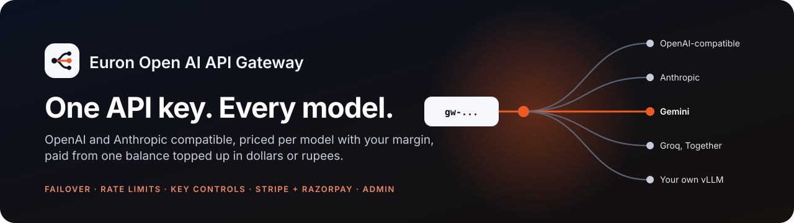
</p>

<p align="center">
  
  <a href="LICENSE"></a>
  
  
  
  
  
  
  
  
  
  
  
</p>

<p align="center">
  <a href="https://github.com/euron-sde-team/euron-open-ai-api-gateway/stargazers"></a>
  <a href="https://github.com/euron-sde-team/euron-open-ai-api-gateway/fork"></a>
  <a href="https://github.com/euron-sde-team/euron-open-ai-api-gateway/watchers"></a>
  <br>
  <a href="https://github.com/euron-sde-team/euron-open-ai-api-gateway/issues"></a>
  <a href="https://github.com/euron-sde-team/euron-open-ai-api-gateway/pulls"></a>
  <a href="https://github.com/euron-sde-team/euron-open-ai-api-gateway/commits/main"></a>
  
  <br>
  <a href="#built-by-the-team-behind-euron"></a>
</p>

<p align="center">
  <b><a href="#-quickstart">Quickstart</a></b> ·
  <b><a href="#️-architecture">Architecture</a></b> ·
  <b><a href="#-explore-the-repository">Explore the repo</a></b> ·
  <b><a href="docs/api/gateway.md">Gateway API</a></b> ·
  <b><a href="docs/api/rest-contract.md">Console API</a></b> ·
  <b><a href="#️-deploy-to-aws">Deploy</a></b> ·
  <b><a href="docs/architecture/security.md">Security</a></b> ·
  <b><a href="#-documentation">Docs</a></b>
</p>

**Euron Open AI API Gateway** is an open-source, self-hosted **AI API gateway**: one API key
that reaches many AI providers, with per-model pricing, your margin on top, and a prepaid
balance your users top up in **US dollars or Indian rupees**. Point any **OpenAI** or
**Anthropic** SDK at it, change the base URL and the key, and keep your code. Behind the key, an
operator connects OpenAI, Anthropic, Google Gemini and any OpenAI-compatible host (Groq,
Together, DeepInfra, OpenRouter, Mistral, Fireworks, your own vLLM), sets what each model costs
and the margin to charge, and watches traffic, revenue, provider cost and provider health from
one control plane. It is MIT-licensed and part of the open-source initiative of **ENGAGESPHERE
TECHNOLOGY PRIVATE LIMITED**.

Developers get a console: API keys with model allow-lists, monthly budgets, rate limits, IP
allow-lists and expiry; a usage log with the exact price of every request; the catalogue with
their prices in USD or INR; a streaming playground; top-ups through Stripe or Razorpay with PDF
receipts; promo codes; and SDK docs. Operators get `/admin`: providers with encrypted
credentials, models and failover routes with costs, margins by default, model, account and key,
rate-limit tiers, accounts and credits, top-ups and refunds, promo codes, live circuit health,
settings and an audit log.

The parts that usually go wrong in a gateway that bills real money are designed in, not bolted on:

- **Spend can never outrun the balance.** Before any provider is called, the worst-case price
  of the request is reserved in one atomic update; after the call the actual price is settled
  in the same transaction as the request row and its ledger entry. Parallel requests cannot
  overspend, and every balance is explained by an append-only ledger.
- **Money comes in exactly once.** Stripe and Razorpay webhooks are verified over the raw body,
  deduplicated, and share one fulfilment path with the browser's return under a row lock, so a
  webhook racing the browser credits once. Rupee orders lock their exchange rate when created.
- **Prices are deliberate.** A model is priced from its primary route's cost plus the margin in
  force (key, then account, then model, then the default, from zero upwards), the same whichever
  provider serves it. A model cannot be switched on without a priced primary route.
- **One provider failing is not your outage.** Routes are tried in priority order with
  failover on timeouts, 429s and 5xx before the first byte, a circuit breaker per route, and
  free health probes every five minutes.
- **Secrets stay secret.** API keys are stored as HMACs and shown once; provider credentials are
  encrypted at rest and never returned; request bodies are kept only for keys that opt in.

Everything runs on a laptop with no API key and no payment account: deterministic stand-ins
answer every endpoint in both formats and play Stripe and Razorpay, an AWS emulator stands in
for SES and Secrets Manager, and it deploys to AWS with the same Terraform.

<p align="center">
  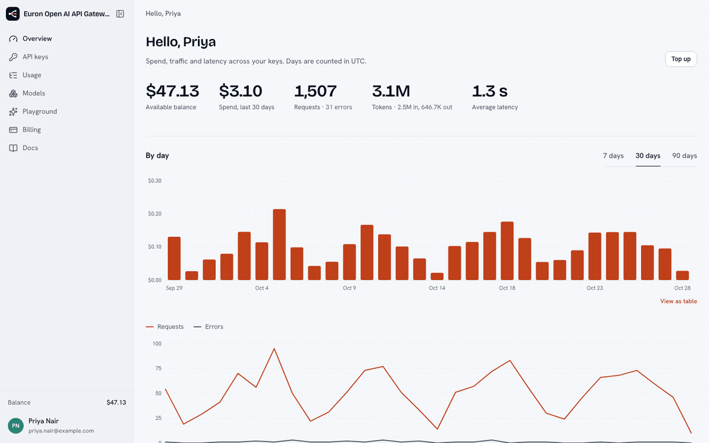
</p>

> [!NOTE]
> Everything in the tour and the screenshots ran for real on a laptop: the gateway's real
> upstream calls, translation, billing and payment clients talking to the local stand-ins over
> the same wire formats the real providers and gateways use. Add a provider key in
> `/admin/providers` and the same models answer for real. `make up && make demo` reproduces it.

<h3 align="center">Built by the team behind Euron</h3>

<p align="center">
  <sub>Euron Open AI API Gateway is part of the open-source initiative of ENGAGESPHERE TECHNOLOGY PRIVATE LIMITED, made by the people who build<br>the platforms below. If you like how this repository is built, come and see what we build with it.</sub>
</p>

<p align="center">
  <a href="https://euron.one"><picture><source media="(prefers-color-scheme: dark)" srcset="docs/assets/brand/euron-dark.svg"></picture></a>
  <a href="https://euronsystems.com"><picture><source media="(prefers-color-scheme: dark)" srcset="docs/assets/brand/euron-systems-dark.svg"></picture></a>
  <a href="https://alphaeuron.com"><picture><source media="(prefers-color-scheme: dark)" srcset="docs/assets/brand/alpha-euron-dark.svg"></picture></a>
</p>

<p align="center">
  <a href="https://www.instagram.com/euron_official"></a>
  <a href="https://www.linkedin.com/company/euronone/posts/"></a>
  <a href="https://x.com/euron712"></a>
  <a href="https://www.youtube.com/@Euron-official"></a>
  <a href="https://whatsapp.com/channel/0029VaeeJwq9RZAfPW9P2l07"></a>
</p>

---

## 📚 Table of contents

- [Why Euron Open AI API Gateway](#-why-euron-open-ai-api-gateway)
- [At a glance](#-at-a-glance)
- [Screenshots](#️-screenshots)
- [Features](#-features)
- [Architecture](#️-architecture)
  - [One request, from key to ledger](#one-request-from-key-to-ledger)
  - [Money](#money)
  - [Data model](#data-model)
- [Tech stack](#-tech-stack)
- [Prerequisites](#-prerequisites)
- [Quickstart](#-quickstart)
- [Connect real providers and payments](#-connect-real-providers-and-payments)
- [Explore the repository](#-explore-the-repository)
- [API](#-api)
- [Configuration](#️-configuration)
- [Deploy to AWS](#️-deploy-to-aws)
- [Security model](#-security-model)
- [Testing](#-testing)
- [Documentation](#-documentation)
- [Roadmap](#️-roadmap)
- [FAQ](#-faq)
- [Contributing, security and license](#-contributing-security-and-license)

---

## 💡 Why Euron Open AI API Gateway

Teams that build on AI end up calling several providers: one model is better at code, another is
cheaper for bulk work, a third is the backup when the first is down. Every provider has its own
key, SDK, bill and rate limit. If you resell access (to your customers, students or internal
teams), you also need prices, a margin, prepaid balances, top-ups in your users' currency, limits
per key, and a way to see who spent what. Most proxies stop at forwarding requests; the money and
the failure modes are left to you.

Euron Open AI API Gateway is a complete gateway you run yourself, with those edges done and tested:

- **One key, both formats.** `/v1/chat/completions` and `/v1/messages` both reach every chat
  model, translated in both directions with streaming, tools and images. Embeddings, images,
  speech and transcription too.
- **Billing you can trust.** Integer micro-dollars end to end, worst-case reservation before the
  call, settlement in one transaction, an append-only ledger, idempotent top-ups, refunds and
  receipts.
- **Margins your way.** A default margin, overridden per model, per account or per key, from zero
  (at cost) upwards, applied to the next request the moment you change it.
- **Control for every key.** Model allow-lists, monthly budgets, RPM and TPM limits, IP
  allow-lists, expiry, instant revocation and opt-in body logging.
- **Reliability built in.** Several providers per model with failover, per-route circuit breakers
  shared across instances, health probes, and the request id of every call in the usage log.
- **India and the rest of the world.** Razorpay (UPI, cards, netbanking) for rupees and Stripe for
  dollars, into one USD balance at a rate locked per order, with optional tax.

## 📊 At a glance

| | |
|---|---|
| **Apps** | Web app (Next.js) with the developer console and the `/admin` control plane; API serving the gateway (`/v1`) and the console API (`/api`); background worker; a stubs server standing in for providers, Stripe and Razorpay |
| **Gateway** | OpenAI Chat Completions, Embeddings, Images, Speech, Transcriptions and Models; Anthropic Messages; streaming; translation between the two formats; failover; per-route circuit breakers |
| **Providers** | Any OpenAI-compatible base URL (OpenAI, Groq, Together, DeepInfra, OpenRouter, Mistral, Fireworks, vLLM), Anthropic, Google Gemini; several credentials per provider, round robin, encrypted at rest |
| **Billing** | One USD balance in micro-dollars; reservations and settlement; ledger; Stripe (USD) and Razorpay (INR) top-ups with a locked rate; tax; receipts; signup credit; promo codes; admin grants and refunds |
| **Controls** | Margins by default, model, account and key; RPM, TPM and concurrency by key and tier; key allow-lists, budgets, IP rules, expiry; body logging opt-in with retention |
| **Monitoring** | Revenue, provider cost and gross margin; requests, errors, p50 and p95 latency and time to first token by model and provider; failovers; circuit state and probes per route; audit log |
| **Mobile-ready API** | Native token mode, a DOM-free typed client, every console flow over plain REST |
| **Tests** | 299 unit, 138 integration on real Postgres and Redis, 6 browser end-to-end with the official OpenAI and Anthropic SDKs and axe |
| **License** | MIT |

## 🖼️ Screenshots

<table>
  <tr>
    <td width="50%"><br><sub><b>Overview.</b> Balance, spend, traffic and latency at a glance.</sub></td>
    <td width="50%">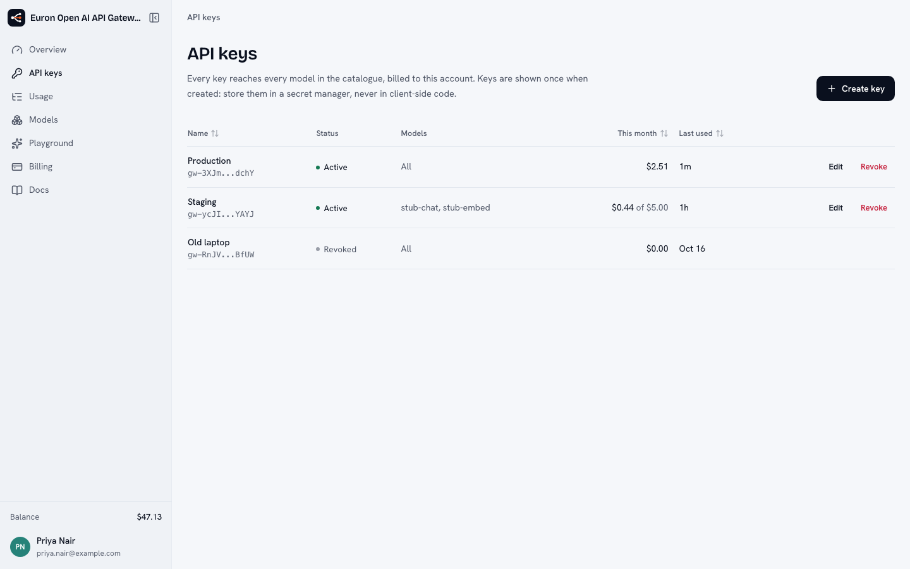<br><sub><b>API keys.</b> Allow-lists, budgets, limits and revocation per key.</sub></td>
  </tr>
  <tr>
    <td>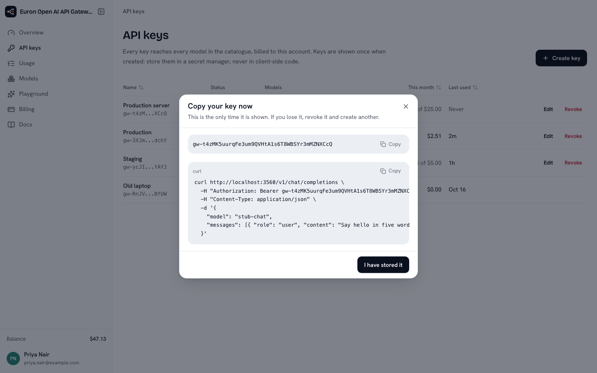<br><sub><b>Shown once.</b> The secret and a working snippet, then only its hint.</sub></td>
    <td>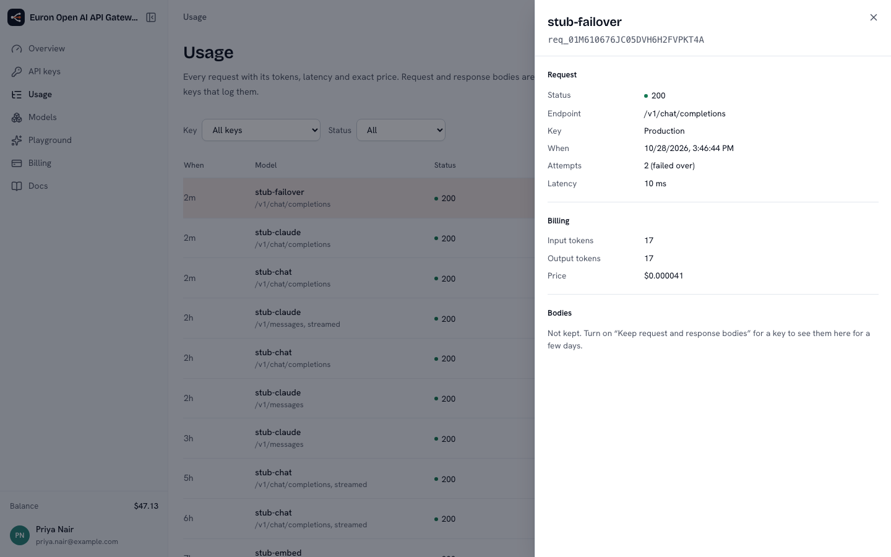<br><sub><b>Usage.</b> Every request with tokens, latency and exact price; this one failed over.</sub></td>
  </tr>
  <tr>
    <td>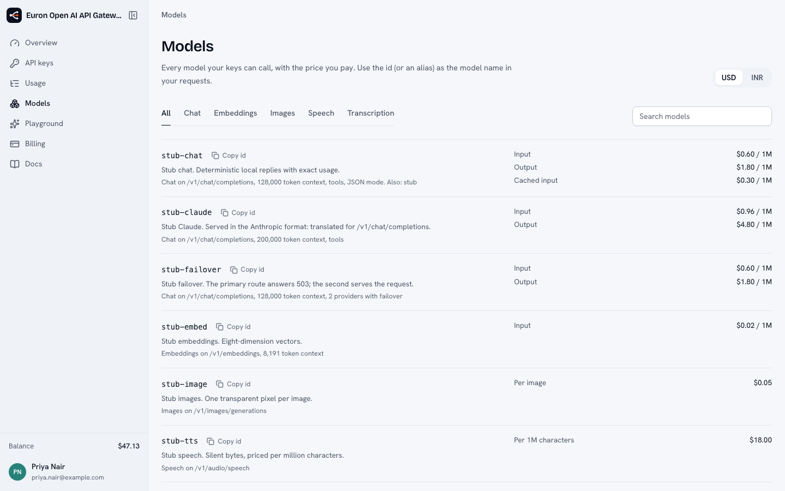<br><sub><b>Models.</b> The catalogue at your prices, in dollars or rupees.</sub></td>
    <td>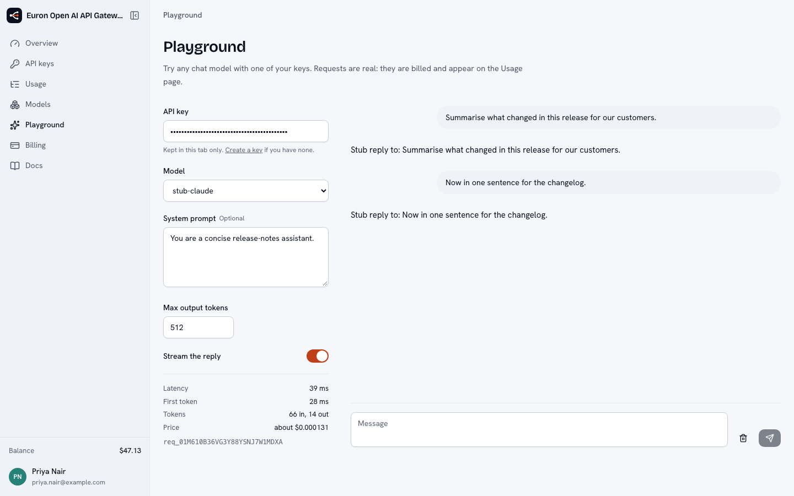<br><sub><b>Playground.</b> Any model with your key, streamed, with latency and price.</sub></td>
  </tr>
  <tr>
    <td>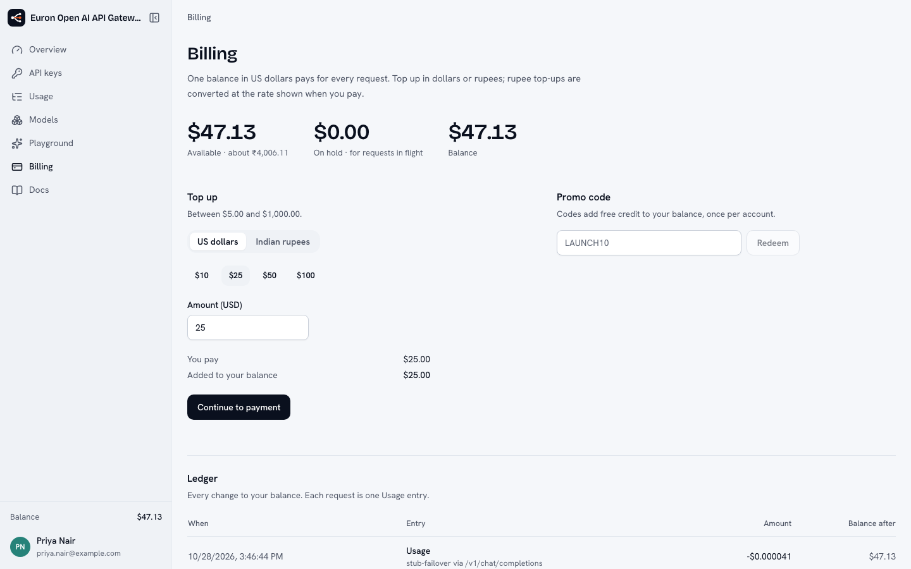<br><sub><b>Billing.</b> Top up through Stripe or Razorpay; every change in the ledger.</sub></td>
    <td>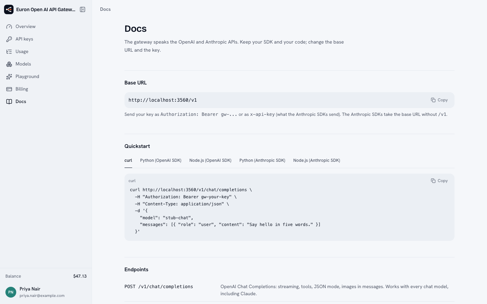<br><sub><b>Docs.</b> Base URL, SDK snippets, endpoints, billing and errors.</sub></td>
  </tr>
  <tr>
    <td>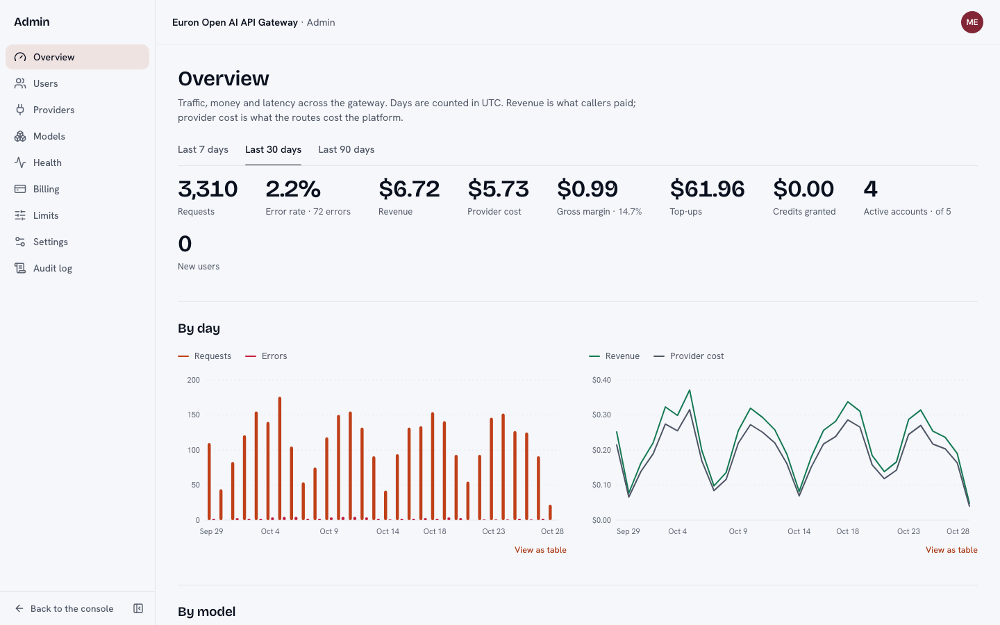<br><sub><b>Admin overview.</b> Revenue against provider cost, latency by model and provider.</sub></td>
    <td>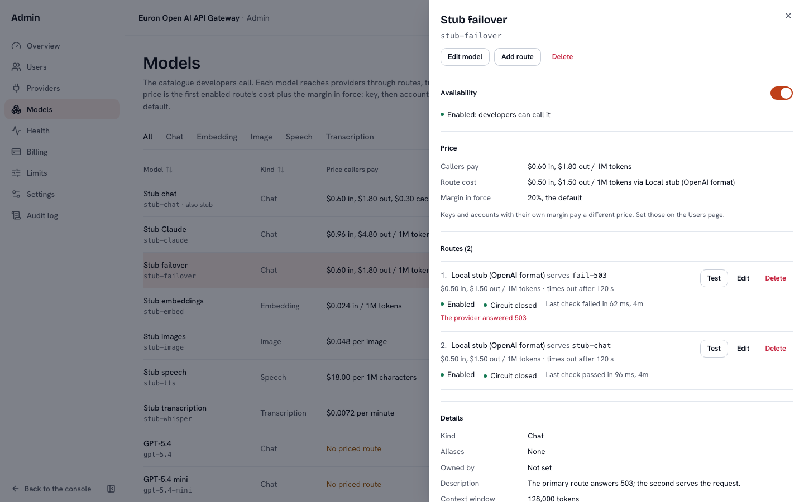<br><sub><b>Admin, Models.</b> Prices, margins and failover routes with a Test button.</sub></td>
  </tr>
  <tr>
    <td>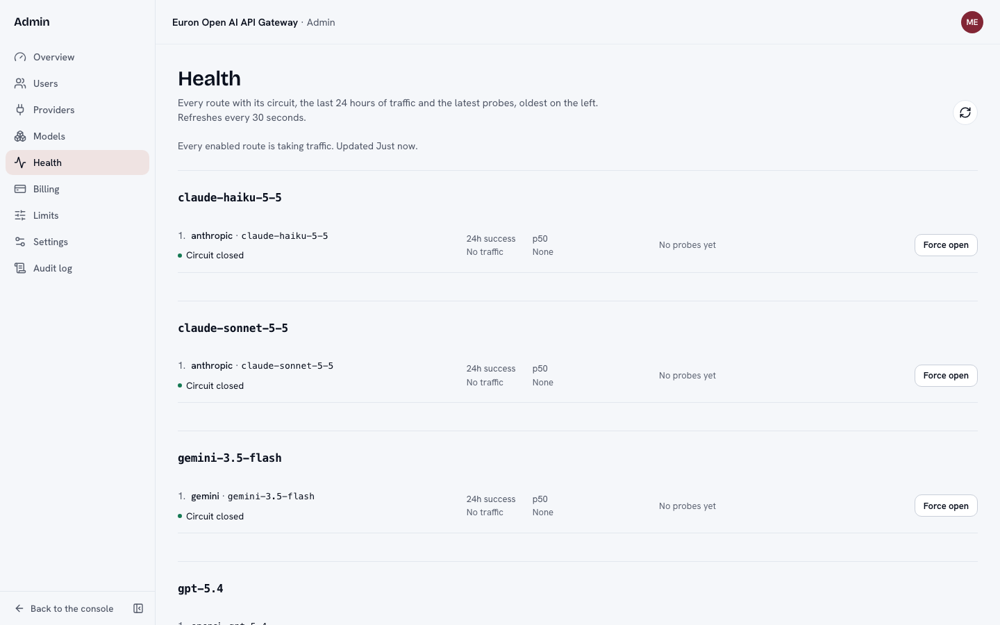<br><sub><b>Admin, Health.</b> Circuits, success rates and probes; force a route open or closed.</sub></td>
    <td>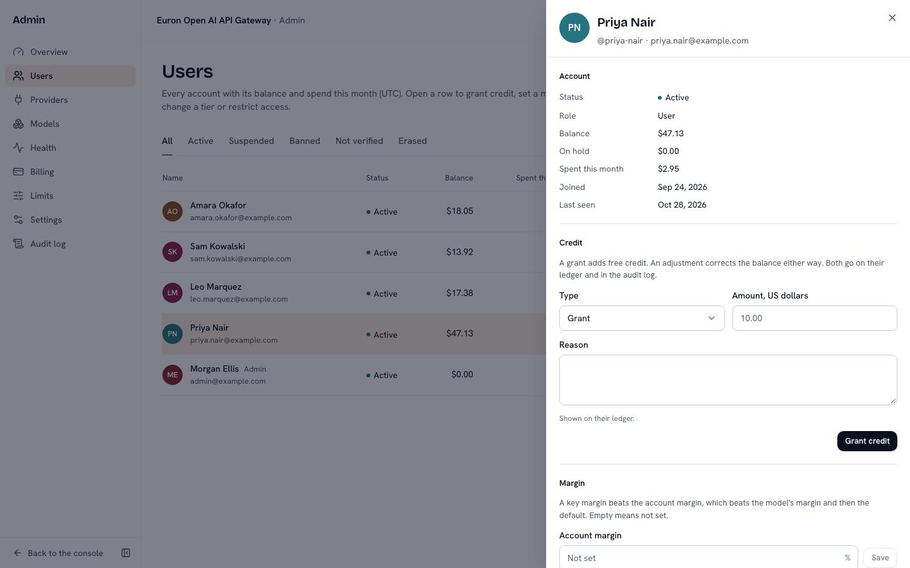<br><sub><b>Admin, Users.</b> Balances, credit, margins per account and per key.</sub></td>
  </tr>
  <tr>
    <td>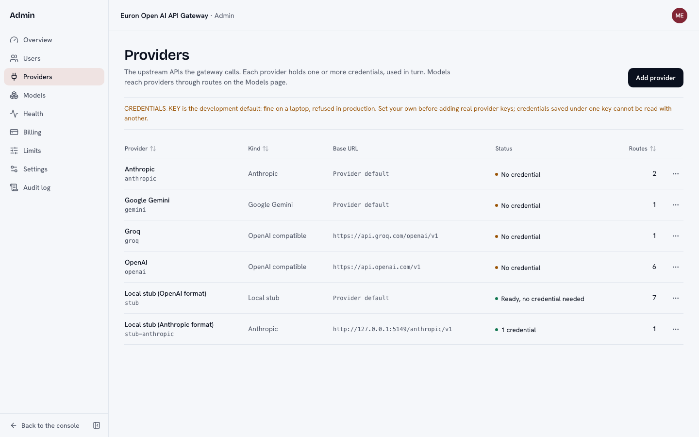<br><sub><b>Admin, Providers.</b> Credentials encrypted on arrival, never shown again.</sub></td>
    <td>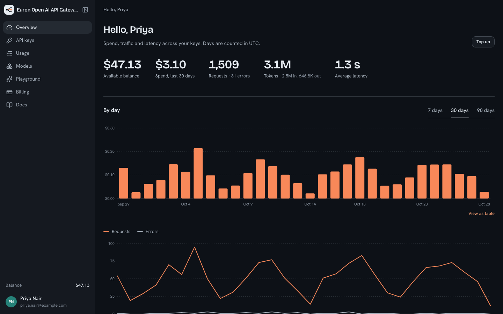<br><sub><b>Dark mode.</b> Every screen, as a token swap.</sub></td>
  </tr>
</table>

## ✨ Features

**For developers**

- One base URL for every model: the OpenAI and Anthropic SDKs work unchanged.
- API keys with a model allow-list, monthly budget, RPM and TPM limits, IP allow-list, expiry,
  instant revocation and optional request and response logging for debugging.
- A usage log with every request's tokens, latency, time to first token, attempts and exact price,
  filterable by key and status, with spend by day, model and key.
- The catalogue with your own prices (per million tokens, per image, per minute) in USD or INR.
- A streaming playground for any chat model.
- Top-ups by card or UPI (Razorpay, in rupees) or card (Stripe, in dollars), PDF receipts, promo
  codes, a welcome credit, and a low-balance email.
- Account security: email verification, two-factor authentication with recovery codes, session
  management, data export and account deletion.

**For operators**

- Providers of any OpenAI-compatible kind plus Anthropic and Gemini, with several encrypted
  credentials each, used round robin.
- Models with public ids and aliases, routes to providers in priority order with their costs, a
  Test button per route, and a guard that keeps unpriced models off.
- Margins: a deployment default, then per model, per account and per key; zero means at cost.
- Rate-limit tiers (RPM, TPM, concurrency) assigned per account.
- Accounts: balances, ledger, credit grants and adjustments with a reason, suspension, bans, erasure.
- Top-ups across accounts with refunds; promo codes with caps and expiry.
- Monitoring: revenue, provider cost, margin, errors, latency percentiles and failovers by model
  and provider; live circuit state with manual override; an audit log of every admin action.
- Settings for registration, default margin, signup credit, tax, top-up limits, low-balance
  threshold and retention, all without a redeploy.

## 🏗️ Architecture

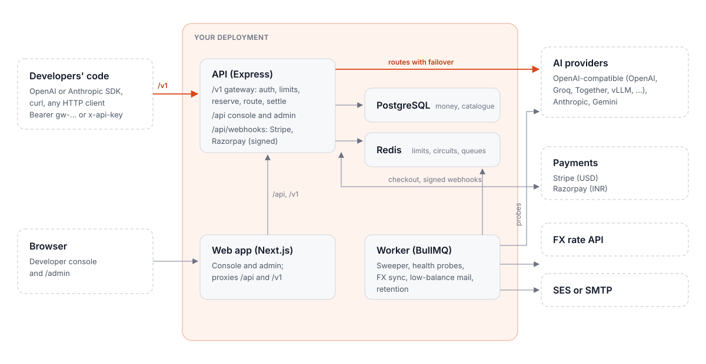

One API process serves the gateway (`/v1`), the console API (`/api`) and the payment webhooks; a
worker runs the scheduled jobs; the web app serves the console and `/admin` and proxies `/api` and
`/v1` on the same origin. Postgres holds money, the catalogue and accounts; Redis holds rate-limit
windows, circuit state, the key cache and queues. [HLD](docs/architecture/HLD.md) and
[LLD](docs/architecture/LLD.md) go deeper.

### One request, from key to ledger


Every `/v1` endpoint hands one function a description of the call; it authenticates the key
(cached for a minute, dropped on any change), resolves the model, applies the key's controls,
prices the call, checks the monthly budget and rate limits, reserves the worst case, tries routes
in priority order (skipping open circuits, failing over before the first byte), and settles the
actual price in one transaction with the request row and the ledger entry. Anything refused before
a provider is called costs nothing. [data-plane.md](docs/architecture/data-plane.md) lists every
step and error.

### Money

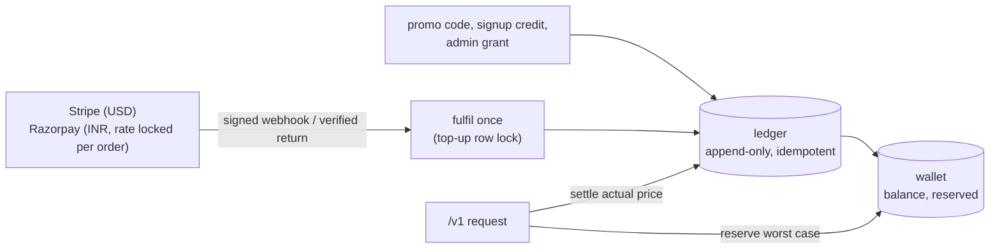

Prices are integer micro-dollars; a model's price is its primary route's cost times one plus the
margin in force. [billing-and-ledger.md](docs/architecture/billing-and-ledger.md),
[pricing-and-margins.md](docs/architecture/pricing-and-margins.md),
[routing-and-failover.md](docs/architecture/routing-and-failover.md).

### Data model

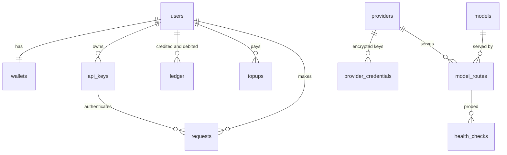

Every table: [data-model.md](docs/architecture/data-model.md).

## 🧰 Tech stack

| Layer | Choice |
|---|---|
| Web | Next.js 15 (App Router), React 19, TanStack Query, Radix UI, Tailwind CSS |
| API | Node.js 22, Express 5, Kysely on PostgreSQL 16, zod, pdfkit |
| Gateway | Plain `fetch` to providers, SSE relay and translation in-house, Redis Lua for limits and circuits |
| Jobs | BullMQ on Redis 7 |
| Payments | Stripe Checkout and Razorpay Orders over their REST APIs (no SDKs) |
| Mail | Amazon SES (or SMTP, or a local outbox) |
| Infrastructure | Terraform, ECS Fargate, ALB, CloudFront and WAF, RDS, ElastiCache, KMS, SES, Secrets Manager, CloudWatch |
| Local AWS | The Floci emulator (SES, KMS, Secrets Manager) and Mailpit |
| Tooling | pnpm workspaces, Turborepo, TypeScript strict, Vitest, Playwright with axe, ESLint |

## 📋 Prerequisites

- Docker with Compose v2 (about 4 GB of memory for the containers)
- Node.js 22 and pnpm 9 (only to run tests or develop outside Docker)
- For real models: a key from any provider you want to offer
- For real payments: a Stripe account (USD) and or a Razorpay account (INR)
- For AWS: an account, a domain in Route 53 with an ACM certificate, and Terraform 1.10 or later

No AWS account, model key or payment account is needed to run it locally.

## 🚀 Quickstart

```bash
git clone https://github.com/euron-sde-team/euron-open-ai-api-gateway.git
cd euron-open-ai-api-gateway
make up      # the stack on emulated AWS, provisioned by the same Terraform as production
make demo    # an admin, four developers with keys, top-ups and 30 days of traffic
```

Open http://localhost:3560 and sign in as `priya.nair@example.com` (a developer with keys and
traffic) or `admin@example.com` (the control plane) with the password `make demo` prints. `make demo`
also prints Priya's API key, once:

```bash
curl http://localhost:5056/v1/chat/completions \
  -H "Authorization: Bearer $GW_KEY" -H "Content-Type: application/json" \
  -d '{"model": "stub-claude", "messages": [{"role": "user", "content": "Hello"}]}'
```

```python
from openai import OpenAI

client = OpenAI(base_url="http://localhost:5056/v1", api_key=GW_KEY)
print(client.chat.completions.create(model="stub-chat", messages=[{"role": "user", "content": "Hi"}]).choices[0].message.content)
```

| URL | What |
|---|---|
| http://localhost:3560 | The console (and `/admin`) |
| http://localhost:5056/v1 | The gateway (also at http://localhost:3560/v1) |
| http://localhost:5056/api/ready | The API readiness check |
| http://localhost:8076 | Mailpit: every email the app sends |
| http://localhost:5149 | The stubs: fake providers, Stripe Checkout and Razorpay |

Locally every model is a deterministic stand-in (`stub-chat`, `stub-claude` in the Anthropic
format, `stub-failover` with a broken primary route, embeddings, images, speech, transcription),
and top-ups go through the stubs' Stripe and Razorpay. `make help` lists every target;
[docs/guides/quickstart-local.md](docs/guides/quickstart-local.md) explains each step.

## 🔑 Connect real providers and payments

1. In **Admin, Providers**, add a credential to OpenAI, Anthropic, Gemini or Groq (or add any
   OpenAI-compatible base URL). It is encrypted on arrival.
2. In **Admin, Models**, check each route's cost against the provider's current price list
   (the starter numbers are a starting point), press **Test**, set a margin if the default does
   not suit, and switch the model on.
3. For payments, set the Stripe and Razorpay keys and webhook secrets (Secrets Manager on AWS,
   `deploy/compose/.env` locally) and point their webhooks at `/api/webhooks/stripe` and
   `/api/webhooks/razorpay`.

Details: [docs/guides/providers.md](docs/guides/providers.md) and
[docs/guides/payments.md](docs/guides/payments.md).

## 🧭 Explore the repository

```
apps/
  api/          Express API and worker (one image, two commands)
    src/
      gateway/      the data plane: auth, catalogue, pricing, limits, breaker,
                    upstream calls, translation, handlers, the request pipeline
      billing/      wallet (reserve, settle, credit) and payments (Stripe, Razorpay)
      routes/       every console endpoint with its contract in a doc comment, plus /v1
      services/     keys, billing, usage, admin, catalogue admin, FX, settings
      jobs/         reservation sweeper, health probes, FX sync, low-balance mail, upkeep
      demo/         the starter catalogue and the demo seed
  web/          Next.js: the developer console and /admin
  stubs/        dependency-free stand-ins for providers, Stripe and Razorpay
packages/
  types/        the API contract
  api-client/   typed client for web and React Native
  ui/           design tokens and primitives
db/migrations/  one SQL migration
deploy/compose/ the local stack (Floci, Mailpit, stubs)
infra/          Terraform modules and environments, Dockerfiles
docs/           architecture, ADRs, API, guides
e2e/            Playwright end-to-end tests
```

[docs/guides/walkthrough.md](docs/guides/walkthrough.md) tours every page of the console and the
control plane.

## 🔌 API

- [Gateway](docs/api/gateway.md): `/v1` endpoints, authentication, translation, streaming,
  billing semantics, error codes, SDK examples.
- [Console REST contract](docs/api/rest-contract.md): envelopes, error codes, pagination, auth
  modes, webhooks.
- [OpenAPI 3.1](docs/api/openapi.yaml): 65 console operations, generated from the route files
  (`pnpm openapi`, checked in CI).
- [`@open-gateway/api-client`](packages/api-client): the typed client the web app uses, ready
  for a mobile app.

## ⚙️ Configuration

Every variable is declared once in [`apps/api/src/core/config.ts`](apps/api/src/core/config.ts) and
documented in [docs/guides/configuration.md](docs/guides/configuration.md). A production API refuses
to boot with development secrets (including the credentials key and the API key pepper), the stub
payment gateway, a localhost web or gateway URL, missing CORS origins, mail to a local outbox or
inline jobs. Business settings (default margin, signup credit, tax, top-up limits, retention)
live in **Admin, Settings**.

## ☁️ Deploy to AWS

```bash
make aws-plan ENV=aws-dev     # terraform plan for infra/terraform/envs/aws-dev
make aws-deploy ENV=aws-dev   # build and push images, apply, run migrations
```

ECS Fargate behind one load balancer (`/api` and `/v1` to the API, with a 300 second idle timeout
for long streams), RDS PostgreSQL, ElastiCache Redis, SES, Secrets Manager and KMS, with CloudFront
and WAF optional in dev and on in prod (never caching `/api` or `/v1`). The credentials key and the
API key pepper are generated into Secrets Manager; payment secrets are filled in by hand.
[docs/guides/deploy-aws.md](docs/guides/deploy-aws.md) walks through the first deploy and
[docs/guides/operations.md](docs/guides/operations.md) through running it.

## 🔐 Security model

- **Ownership is a 404.** Keys, top-ups, receipts, usage and request bodies are scoped by owner;
  another account's do not exist for you.
- **Money is transactional.** Reservation before the call, settlement with the request row and the
  ledger entry in one transaction, one idempotent fulfilment for top-ups, signatures checked over
  raw bodies, amounts compared with the order.
- **Secrets are never returned.** API keys are HMACs shown once; provider credentials are encrypted
  with a key outside the database and returned only as a label and the last four characters;
  provider error bodies never reach callers.
- **Admins cannot read prompts.** Request bodies are kept only for keys whose owner opts in, for a
  few days, and only the owner can read them.
- **Strict headers.** A per-request Content-Security-Policy with a nonce, `connect-src 'self'`, and
  frames only for Razorpay's checkout.

What is left (estimates that can run low, budgets overshot by requests in flight, Redis-dependent
limits failing open): [docs/architecture/security.md](docs/architecture/security.md) and
[docs/architecture/threat-model.md](docs/architecture/threat-model.md).

## 🧪 Testing

```bash
pnpm lint && pnpm typecheck && pnpm test        # unit tests in every package
make test-integration                          # the API against real Postgres and Redis
make e2e                                       # Playwright against the running stack
```

| Suite | Count | Where |
|---|---|---|
| API unit | 121 | `apps/api/test/unit`: translation, pricing, estimates, signatures, IP rules, keys, encryption |
| API integration | 138 | `apps/api/test/integration`, against Postgres 16 and Redis 7 with the stubs in-process |
| Web unit and components | 120 | `apps/web/test`: console and admin helpers and pages |
| API client and UI kit | 47 | `packages/api-client/test`, `packages/ui/test` |
| Stubs | 11 | `apps/stubs/test` |
| End to end | 6 | `e2e/tests`: the official OpenAI and Anthropic SDKs against the stack, checkout, admin, and axe on every page in both themes |

The integration suite proves the guarantees above: parallel requests cannot spend past a balance,
a refused request costs nothing and never reaches a provider, streamed and plain requests settle
exactly once at the snapshot price, margins follow their precedence, a free primary route cannot
be enabled, failover happens on 503 and not after the first streamed byte, circuits open and
recover, every key control and rate limit holds, a webhook racing the browser credits once at the
locked rate, another account gets 404, and no response or table ever contains a provider key in
clear. [docs/guides/testing.md](docs/guides/testing.md) has the details.

## 📖 Documentation

| | |
|---|---|
| Architecture | [HLD](docs/architecture/HLD.md), [LLD](docs/architecture/LLD.md), [data plane](docs/architecture/data-plane.md), [billing and ledger](docs/architecture/billing-and-ledger.md), [pricing and margins](docs/architecture/pricing-and-margins.md), [routing and failover](docs/architecture/routing-and-failover.md), [rate limits](docs/architecture/rate-limits.md), [data model](docs/architecture/data-model.md) |
| Security | [security](docs/architecture/security.md), [threat model](docs/architecture/threat-model.md) |
| Decisions | [architecture decision records](docs/architecture/adr) |
| API | [gateway](docs/api/gateway.md), [console REST contract](docs/api/rest-contract.md), [OpenAPI](docs/api/openapi.yaml) |
| Guides | [quickstart](docs/guides/quickstart-local.md), [walkthrough](docs/guides/walkthrough.md), [providers](docs/guides/providers.md), [payments](docs/guides/payments.md), [configuration](docs/guides/configuration.md), [deploy to AWS](docs/guides/deploy-aws.md), [operations](docs/guides/operations.md), [testing](docs/guides/testing.md), [troubleshooting](docs/guides/troubleshooting.md), [mobile clients](docs/guides/mobile-clients.md) |

## 🗺️ Roadmap

- Teams: several people sharing one balance, with roles and per-member keys.
- Auto-recharge from a saved payment method when the balance runs low.
- The OpenAI Responses API and reranking endpoints.
- Weighted load balancing across routes of equal priority, and latency-aware routing.
- Spend alerts per key and per account, and a usage export.

## ❓ FAQ

<details>
<summary><b>Do I need an API key or a payment account to try it?</b></summary>

No. `make up && make demo` runs everything with deterministic stand-ins: every model answers from
the stubs server in the OpenAI or Anthropic format, and top-ups go through the stubs' Stripe and
Razorpay. Add a provider credential in Admin, Providers to serve real models.
</details>

<details>
<summary><b>Which SDKs and tools work with it?</b></summary>

Anything that speaks the OpenAI API (the OpenAI SDKs, LangChain, LlamaIndex, the Vercel AI SDK,
most coding tools) with the base URL set to your gateway's `/v1`, and anything that speaks the
Anthropic Messages API with the base URL set to the gateway's root. Every chat model is reachable
from both.
</details>

<details>
<summary><b>How is a request priced?</b></summary>

From the tokens (or images, characters, minutes) the provider reports, at the model's price: its
primary route's cost times one plus the margin in force. The margin is the key's, else the
account's, else the model's, else the deployment default, and it can be zero. The exact price of
every request is on the Usage page and in the ledger.
</details>

<details>
<summary><b>What happens when a user runs out of balance mid-request?</b></summary>

It cannot happen: the worst case is reserved before the provider is called, so a request either
fits and completes or is refused with 402 up front. Settling the actual price releases the rest of
the hold.
</details>

<details>
<summary><b>Why one dollar balance instead of a rupee balance?</b></summary>

Providers bill in dollars, so prices are in dollars. Rupee top-ups are converted at the rate shown
at checkout, locked into the order, so a buyer is credited exactly what they were told. The console
shows rupee equivalents everywhere a buyer might want them.
</details>

<details>
<summary><b>Can admins read what users send to models?</b></summary>

No. The gateway stores request metadata (model, tokens, latency, price). Bodies are stored only when
a key's owner turns logging on, for a few days, and only that owner can read them.
</details>

## 🤝 Contributing, security and license

- [CONTRIBUTING.md](CONTRIBUTING.md): how to set up, the checks a pull request must pass, and the
  coding conventions.
- [SECURITY.md](SECURITY.md): how to report a vulnerability privately.
- [CODE_OF_CONDUCT.md](CODE_OF_CONDUCT.md).
- [MIT License](LICENSE).
