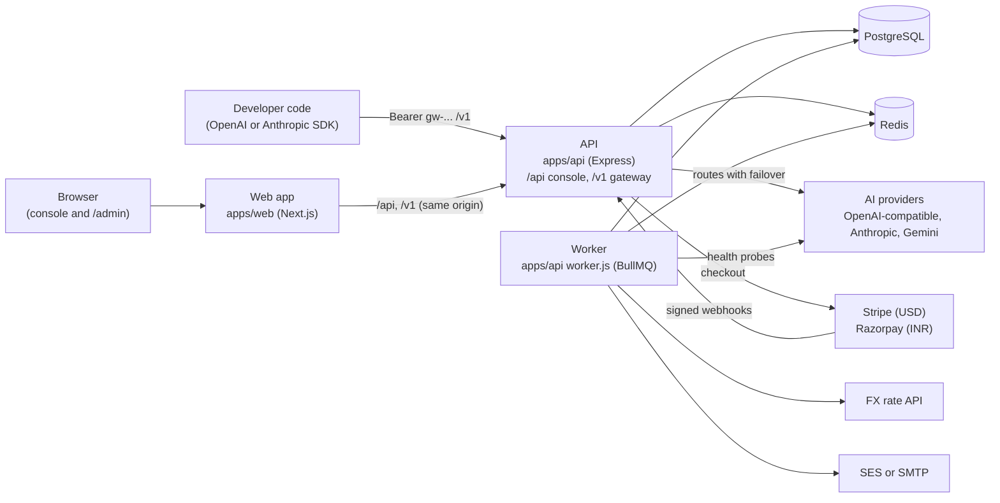
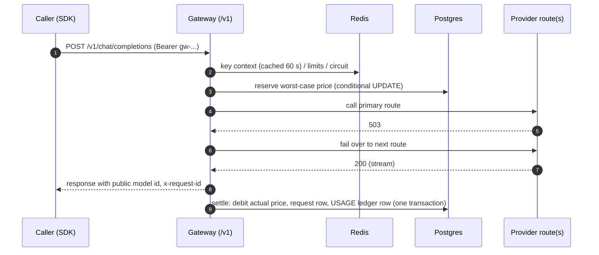
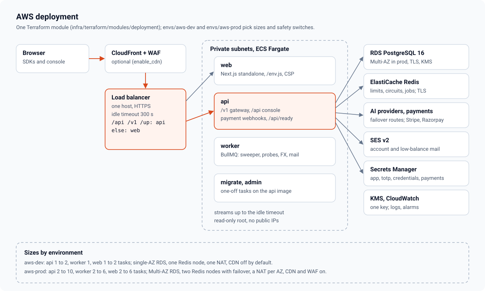

# High-level design

Euron Open AI API Gateway is a self-hosted AI API gateway. Developers create an account,
top up a balance, create API keys and call many AI models through one OpenAI and
Anthropic compatible endpoint. Each request is routed to a provider, priced at the
provider's cost plus the operator's margin, and paid from the account's balance. The
operator runs the deployment from `/admin`: providers and their credentials, the model
catalogue and its prices, margins, rate-limit tiers, accounts, top-ups, promo codes,
monitoring and provider health.

One deployment serves one operator ([ADR 0002](adr/0002-single-tenant.md)). Paths are
relative to the repository root.

| Topic | Page |
| --- | --- |
| Modules and flows inside the API and the web app | [LLD.md](LLD.md) |
| One request, step by step | [data-plane.md](data-plane.md) |
| Wallet, reservations, ledger, top-ups, credits | [billing-and-ledger.md](billing-and-ledger.md) |
| Routes, failover, the circuit breaker, health probes | [routing-and-failover.md](routing-and-failover.md) |
| Costs, margins and prices | [pricing-and-margins.md](pricing-and-margins.md) |
| RPM, TPM and concurrency | [rate-limits.md](rate-limits.md) |
| Every table | [data-model.md](data-model.md) |
| Security controls | [security.md](security.md) |
| STRIDE analysis and residual risks | [threat-model.md](threat-model.md) |
| Decisions and their trade-offs | [adr/](adr/README.md) |
| The HTTP contracts | [../api/gateway.md](../api/gateway.md), [../api/rest-contract.md](../api/rest-contract.md) |

## 1. System context

## 2. What runs

| Process | Code | Does |
| --- | --- | --- |
| API | `apps/api/src/index.ts` | The console REST API under `/api` (accounts, keys, billing, usage, admin), the data plane under `/v1`, payment webhooks under `/api/webhooks` |
| Worker | `apps/api/src/worker.ts` | Scheduled jobs: release expired reservations (every minute), probe every route (5 min), fetch the INR rate (6 h), low-balance emails (10 min), lift suspensions, purge deleted accounts, retention |
| Web | `apps/web` | The developer console (overview, keys, usage, models, playground, billing, docs, settings) and `/admin`. Proxies `/api` and `/v1` to the API in development; a load balancer does it in production |
| Stubs | `apps/stubs/server.mjs` | Development and tests only: fake OpenAI-format and Anthropic-format providers, fake Stripe and Razorpay |

The API is stateless: scale it horizontally. Shared state is in Postgres (money, the
catalogue, accounts) and Redis (rate-limit windows, circuit state, key-context cache,
monthly key spend, queues).

## 3. One request

Step by step, with every error a caller can get: [data-plane.md](data-plane.md).

## 4. Money

- One balance per account in integer micro-USD, plus the amount on hold for requests in
  flight ([ADR 0003](adr/0003-wallet-reservations-ledger.md)).
- Top-ups: Stripe Checkout for USD, Razorpay checkout.js for INR (converted at a rate
  locked into the order, [ADR 0004](adr/0004-one-usd-ledger.md)), a stub gateway in
  development. Webhooks and the browser's return share one idempotent fulfilment.
- Free credit: a signup credit when an account becomes active, promo codes, admin grants.
- Price per request: the model's primary route cost times one plus the margin in force
  (key, account, model, default; [ADR 0005](adr/0005-pricing-primary-route-and-margin.md)).

Details: [billing-and-ledger.md](billing-and-ledger.md), [pricing-and-margins.md](pricing-and-margins.md).

## 5. Formats

`/v1/chat/completions`, `/v1/embeddings`, `/v1/images/generations`, `/v1/audio/speech`,
`/v1/audio/transcriptions` and `/v1/models` speak OpenAI's format; `/v1/messages` speaks
Anthropic's. Chat models are reachable from both, with translation in both directions,
streams included ([ADR 0006](adr/0006-format-translation.md)).

## 6. Where data lives

| Data | Where | Kept |
| --- | --- | --- |
| Accounts, sessions, keys (hashed), wallets, ledger, top-ups | Postgres | Until the account is erased; ledger and top-ups kept as financial records, pointing at the anonymised account |
| Request metadata | Postgres `requests` | Forever, or `requestRetentionDays` |
| Request and response bodies | Postgres `request_bodies` | Only for keys that opt in; `bodyRetentionDays` (7 by default) |
| Catalogue, routes, prices, provider credentials (encrypted) | Postgres | Until deleted in admin |
| Rate-limit windows, circuits, key-context cache, key spend | Redis | Minutes to 40 days, all rebuildable |
| Audit log | Postgres | Forever |

## 7. Deployment

AWS: ECS Fargate services for the API, worker and web behind one ALB (`/api/*` and `/v1/*`
to the API, the rest to the web), RDS PostgreSQL, ElastiCache Redis, Secrets Manager,
SES, optional CloudFront and WAF. The ALB idle timeout is 300 seconds so long streams are
not cut. Locally: the same Terraform against the Floci emulator, or plain Docker Compose.
Guide: [../guides/deploy-aws.md](../guides/deploy-aws.md).

## 8. Quality

- 136 integration tests run the real API in-process against Postgres, Redis and the stubs:
  billing races, parallel spend, failover, the breaker, translation, every key control,
  rate limits, webhooks, refunds, erasure, secrets never leaking.
- Unit tests pin translation, pricing, token estimates, signatures, IP rules, key format
  and encryption; web tests cover the console and admin helpers and pages.
- Playwright drives the console end to end; the OpenAPI reference is generated from the
  route files and checked in CI.
