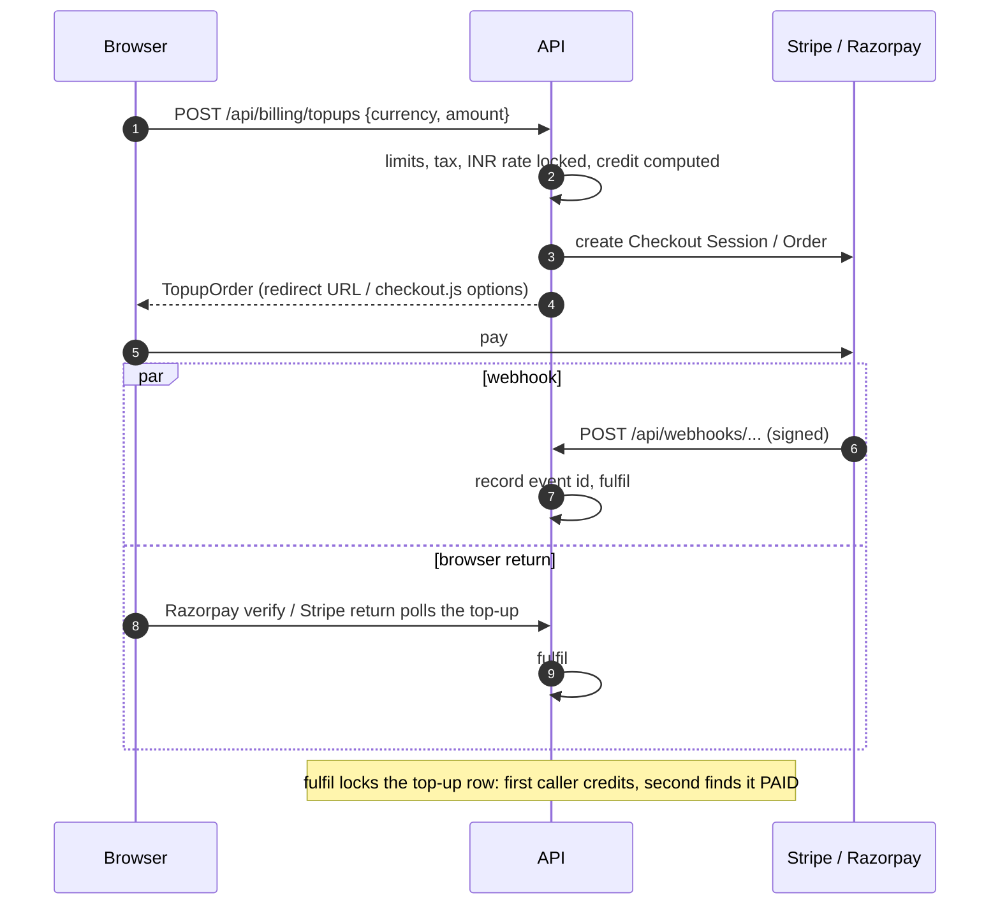

# Billing and the ledger

How money enters an account, how requests spend it, and how every change is recorded.
Decisions: [ADR 0003](adr/0003-wallet-reservations-ledger.md) (reserve, settle, ledger) and
[ADR 0004](adr/0004-one-usd-ledger.md) (one USD balance, locked INR rate).

## Units

| Quantity | Unit | Type |
| --- | --- | --- |
| Balances, prices, costs, credits | micro-USD (1 USD = 1 000 000) | `bigint` |
| Token prices | micro-USD per million tokens | `bigint` |
| Unit prices | micro-USD per image, per million characters (speech), per minute (transcription) | `bigint` |
| Margins, tax | basis points (1 500 = 15 %) | `integer` |
| Top-up amounts | minor units of the currency (cents, paise) | `bigint` |
| INR rate | rupees per US dollar | `numeric(12,6)` |

All rounding is up for charges and down for credits.

## The wallet

`wallets(user_id, balance_micros, reserved_micros)`. Available = balance - reserved.

| Operation | When | SQL shape |
| --- | --- | --- |
| reserve | before a provider call | `UPDATE wallets SET reserved = reserved + x WHERE user_id = ? AND balance - reserved >= x`; no row means 402 |
| settle | after the call | in one transaction: lock the reservation, `balance -= price`, `reserved -= hold`, insert the request row, insert the `USAGE` ledger row (`ON CONFLICT DO NOTHING` on the reference, refunding the debit if it was already booked) |
| release | the call failed | mark the reservation released, `reserved -= hold` |
| credit | top-ups, grants, promo codes, signup credit, refunds, adjustments | lock the wallet row, skip if `(ref_type, ref_id, type)` exists, update the balance, insert the ledger row |
| sweep | every minute | release reservations past `expires_at` (15 minutes after they were made) |

The actual price can exceed the hold when an estimate ran low. It is charged in full; the
balance may go slightly negative, and new requests are refused until the account tops up.

## The ledger

`ledger(id, user_id, type, amount_micros, balance_after_micros, ref_type, ref_id,
description, created_by, created_at)`, append-only, with a unique index on
`(ref_type, ref_id, type)`.

| Type | Sign | Reference | Written by |
| --- | --- | --- | --- |
| `SIGNUP` | + | `signup` / user id | account activation (verification, or sign-up when verification is off) |
| `TOPUP` | + | `topup` / top-up id | payment fulfilment |
| `PROMO` | + | `promo` / `promo id:user id` | promo redemption |
| `GRANT` | + | `admin` / a new id | an admin, with a reason |
| `ADJUSTMENT` | + or - | `admin` / a new id | an admin, with a reason |
| `USAGE` | - | `request` / request id | settlement |
| `REFUND` | - | `topup` / top-up id | an admin refunding a top-up |

Invariant: an account's balance equals the sum of its ledger entries. The integration
tests check it after races.

## Top-ups

1. **Create** ([`services/billing.service.ts`](../../apps/api/src/services/billing.service.ts)):
   the amount must be inside the configured limits; tax (`taxBps`) is added on top; for INR
   the current rate is read and stored on the order; the credit is computed
   (`amount_minor x 10 000` micro-USD for USD, `floor(amount_minor x 10 000 / rate)` for
   INR); the gateway order is created; the `topups` row is stored `CREATED`.
2. **Pay**: Stripe Checkout (hosted page, redirect back to `/billing?topup=<id>`) or
   Razorpay checkout.js (modal); in development a stub gateway confirms in the browser.
3. **Fulfil** (one function, three callers: the webhook, Razorpay's verify call, the stub
   confirm): lock the top-up row; if it is already `PAID` stop; compare the paid amount
   and currency with the order (a mismatch marks it `FAILED` with `AMOUNT_MISMATCH` and
   credits nothing); mark it `PAID` with the gateway payment id (unique per gateway);
   credit `TOPUP`; audit.
4. **Webhooks** ([`billing/payments.ts`](../../apps/api/src/billing/payments.ts)): the
   signature is checked over the raw body first (Stripe: `t=,v1=` HMAC with a 300 second
   tolerance; Razorpay: HMAC of the body). The event id is recorded in
   `payment_webhook_events` in the same transaction as fulfilment, so a duplicate delivery
   stops there and a failed fulfilment is retried by the gateway.

Refunds: an admin marks a paid top-up `REFUNDED`, which books a negative `REFUND` of its
credit. The money itself is returned from the gateway's dashboard.

Receipts: `GET /api/billing/topups/:id/receipt.pdf` renders a PDF for paid and refunded
top-ups (amount, tax, total, locked rate, credit).

## Free credit

- **Signup credit** (`signupCreditMicros`, $1 by default): booked once per account when it
  becomes active.
- **Promo codes**: amount, optional maximum redemptions and expiry, once per account
  (`promo_redemptions` primary key), counted under the code's row lock.
- **Admin grants and adjustments**: from the user panel in `/admin`, with a reason, audited.

## Low balance

Every 10 minutes the worker emails accounts whose available balance is below
`lowBalanceMicros` and that have made at least one request, once; the flag resets on the
next credit.
