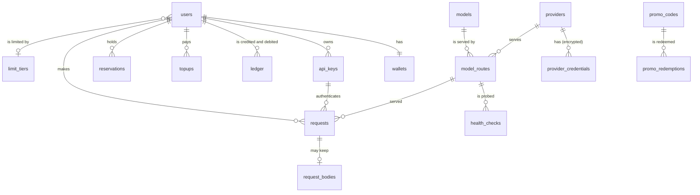

# Data model

The whole schema is one migration, [`db/migrations/0001_init.sql`](../../db/migrations/0001_init.sql).
Kysely types are in [`apps/api/src/db/types.ts`](../../apps/api/src/db/types.ts).

## Conventions

- Primary keys are ULIDs stored as `text`. Provider ids are slugs; model ids are the public
  model names (`gpt-5.4`, `vendor/model`); request ids are `req_` plus a ULID.
- Money is `bigint` micro-USD; margins and tax are `integer` basis points; top-up amounts
  are `bigint` minor units; the INR rate is `numeric(12,6)` ([billing-and-ledger.md](billing-and-ledger.md)).
- Timestamps are `timestamptz(3)` and the API runs with `TZ=UTC`.
- Lists page with keyset cursors on `(created_at, id)`, never `OFFSET`.
- No tenant column ([ADR 0002](adr/0002-single-tenant.md)).
- API keys are stored as HMACs; provider credentials are encrypted
  ([ADR 0008](adr/0008-provider-credentials-encrypted.md)).
- Extensions: `citext` (case-insensitive email, username, promo codes), `pg_trgm`.

## Enums

| Enum | Values |
| --- | --- |
| `user_role` | `USER`, `ADMIN` |
| `user_status` | `PENDING_VERIFICATION`, `ACTIVE`, `SUSPENDED`, `BANNED`, `DEACTIVATED` (erased) |
| `provider_kind` | `OPENAI_COMPATIBLE`, `ANTHROPIC`, `GEMINI`, `STUB` |
| `model_kind` | `CHAT`, `EMBEDDING`, `IMAGE`, `SPEECH`, `TRANSCRIPTION` |
| `api_key_status` | `ACTIVE`, `REVOKED` |
| `ledger_type` | `TOPUP`, `GRANT`, `PROMO`, `SIGNUP`, `USAGE`, `REFUND`, `ADJUSTMENT` |
| `reservation_status` | `HELD`, `SETTLED`, `RELEASED` |
| `payment_gateway` | `STRIPE`, `RAZORPAY`, `STUB` |
| `topup_status` | `CREATED`, `PAID`, `FAILED`, `REFUNDED` |

## Identity

| Table | Holds |
| --- | --- |
| `users` | email, username, display name, bcrypt hash, role, status, TOTP (encrypted secret, last step), `token_version`, `limit_tier_id` (null: the default tier), `margin_bps` (account margin override), deletion request, last seen |
| `sessions` | refresh token families: SHA-256 of the token, rotation chain (`replaced_by`), user agent, IP, expiry, revocation |
| `auth_tokens` | single-use email verification and password reset tokens (hashes) |
| `totp_recovery_codes` | HMACs of recovery codes, used once |
| `limit_tiers` | name, `rpm`, `tpm`, `concurrency` (null: unlimited), `is_default` (one row) |

## Keys

`api_keys`: owner, name, `key_hash` (HMAC-SHA256 with the pepper, unique), `display_hint`
(`gw-abcd...wxyz`), status, `expires_at`, `allowed_models[]` (empty: all),
`monthly_budget_micros`, `rpm`, `tpm`, `ip_allowlist[]`, `log_bodies`, `margin_bps` (admin
override), `last_used_at`, `revoked_at`. Revoked keys stay so usage history keeps its name.

## Money

| Table | Holds | Notes |
| --- | --- | --- |
| `wallets` | `balance_micros`, `reserved_micros` (>= 0), `low_balance_notified_at` | one per account |
| `ledger` | type, signed `amount_micros`, `balance_after_micros`, `ref_type`, `ref_id`, description, `created_by` | append-only; unique `(ref_type, ref_id, type)` |
| `reservations` | `amount_micros`, status, `expires_at` | partial index on held rows by expiry, for the sweeper |
| `topups` | gateway, currency, `amount_minor`, `tax_minor`, `total_minor`, `fx_inr_per_usd`, `credit_micros`, `gateway_order_id`, `gateway_payment_id`, status, failure reason, paid and refunded times | unique per gateway order and per gateway payment |
| `payment_webhook_events` | `(gateway, event_id)` | dedupes deliveries; kept 90 days |
| `fx_rates` | `inr_per_usd`, source, fetched at | newest row wins while under two days old |
| `promo_codes` | `code` (citext, unique), `amount_micros`, `max_redemptions`, `redeemed_count`, `expires_at`, `active` | |
| `promo_redemptions` | `(promo_id, user_id)` primary key | once per account |

## The catalogue

| Table | Holds |
| --- | --- |
| `providers` | slug id, kind, display name, `base_url` (null: the kind's default), enabled |
| `provider_credentials` | label, `ciphertext` (`v1:` AES-256-GCM, AAD = id), `last4`, enabled, disabled reason |
| `models` | public id, kind, display name, description, owner, `aliases[]` (GIN index), context window, max output, tools/vision/JSON flags, `margin_bps`, enabled (default false), sort order |
| `model_routes` | model, provider, `upstream_model`, `priority` (1 is primary), `timeout_ms`, `input_micros_per_mtok`, `output_micros_per_mtok`, `cached_micros_per_mtok`, `unit_micros`, enabled; unique `(model, provider, upstream_model)` |
| `health_checks` | route, ok, latency, error, checked at; kept 14 days |

## Requests

`requests`: owner, key, `model_id` (the public id), `route_id`, `provider_id`, endpoint,
stream, `status_code`, `error_code`, attempts, input/output/cached tokens, `units`
(images, characters or minutes), `estimated`, `latency_ms`, `ttfb_ms`, `cost_micros`,
`price_micros`, `margin_bps`, caller IP, created at. Indexed by owner and time, by key and
time (monthly budgets), by model and time, and by time (admin overview).

`request_bodies`: request id, the request and response as JSON, `expires_at`. Only for
keys with `log_bodies`; deleted when expired or when the account is erased.

## Operations

| Table | Holds |
| --- | --- |
| `settings` | one JSON document (`key = 'app'`) merged over the defaults: name, tagline, registration, gateway base URL, default margin, signup credit, tax, top-up limits, low-balance threshold, retention |
| `audit_log` | actor, action, entity, IP, JSON data; every admin action, key change, top-up and promo event |

## What is deleted when

| Event | Effect |
| --- | --- |
| A key is revoked | status `REVOKED`; the row and its request history stay |
| An account is erased (admin, or the purge job after the 14-day grace period) | identity anonymised, sessions and tokens deleted, every key revoked, logged bodies deleted; wallet, ledger, top-ups and request metadata stay as financial records |
| Retention runs | expired bodies; request rows older than `requestRetentionDays` when set; probes older than 14 days; webhook ids older than 90 days |
| A model or provider is deleted | its routes cascade; requests keep the model id and provider id as text |
