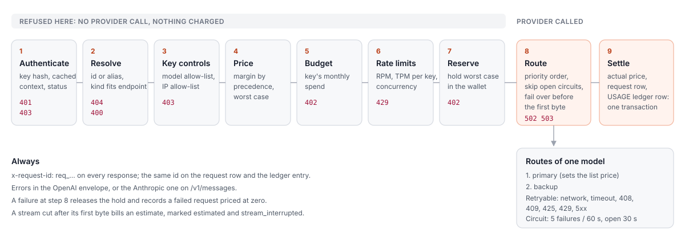

# The data plane

How one `/v1` request is handled, in order, and what each step can answer. The order is
fixed in one function, `runCall` in
[`apps/api/src/gateway/pipeline.ts`](../../apps/api/src/gateway/pipeline.ts)
([ADR 0007](adr/0007-request-pipeline.md)). Each endpoint in
[`apps/api/src/gateway/handlers.ts`](../../apps/api/src/gateway/handlers.ts) validates its
body, then gives `runCall` a `CallSpec`: the endpoint, the format, the model name, the
model kinds it accepts, how to estimate the call, and how to execute it on one route.

## Steps

| # | Step | Where | Refused with |
| --- | --- | --- | --- |
| 0 | Body checks per endpoint (messages present, `max_tokens` on `/v1/messages`, `n` limits, audio file present, body size) | `handlers.ts`, `routes/v1.routes.ts` | 400 `invalid_request`, 400 `invalid_json`, 413 `request_too_large` |
| 1 | **Authenticate**: `Authorization: Bearer` or `x-api-key`; shape check; HMAC lookup (context cached in Redis 60 s); key active and not expired; account `ACTIVE` | `gateway/auth.ts` | 401 `missing_api_key`, `invalid_api_key`, `expired_api_key`; 403 `account_restricted` |
| 2 | **Resolve the model** by id or alias, case-insensitive, from the cached catalogue (enabled models with at least one usable route) | `gateway/catalog.ts` | 400 `model_required`; 404 `model_not_found`; 400 `model_not_supported` (wrong endpoint for the kind) |
| 3 | **Key controls**: model allow-list, IP allow-list | `pipeline.ts`, `auth.ts` | 403 `model_not_allowed`, `ip_not_allowed` |
| 4 | **Price**: margin = key ?? account ?? model ?? default; list price from the primary route's cost; worst case from the estimate | `gateway/pricing.ts`, `gateway/tokens.ts` | |
| 5 | **Monthly budget** of the key: spend this month (Redis, seeded from `requests`) plus the worst case | `pipeline.ts` | 402 `budget_exceeded` |
| 6 | **Rate limits**: RPM and TPM per key, then a concurrency slot per account | `gateway/limits.ts` | 429 `rate_limit_exceeded`, `tokens_rate_limit_exceeded`, `concurrency_limit_exceeded` with `retry-after` |
| 7 | **Reserve** the worst case in the wallet | `billing/wallet.ts` | 402 `insufficient_balance` |
| 8 | **Route**: try routes in priority order, skipping open circuits; fail over on retryable errors while nothing has been sent | `pipeline.ts`, `gateway/upstream.ts`, `gateway/breaker.ts` | 503 `no_route_available` (every circuit open), 502 `upstream_unavailable` (retryable failures everywhere), 502 `upstream_error` or 400 `upstream_rejected` (a non-retryable provider answer) |
| 9 | **Settle**: actual price from the reported usage; one transaction debits the wallet, drops the hold, inserts the `requests` row (and `request_bodies` when the key logs them) and books the `USAGE` ledger row | `wallet.ts` `settle` | |

Failures at steps 0 to 7 never reach a provider and cost nothing. A failure at step 8
releases the hold and records a failed request row priced at zero. Steps 1 to 7 run before
any byte of the response, so every refusal is a clean JSON error.

## Estimates

The reservation and the TPM check need a number before the provider answers
([`gateway/tokens.ts`](../../apps/api/src/gateway/tokens.ts)):

- **Chat**: about four characters per token for text, 1 200 tokens per image part, four
  per message, plus tools and system prompts. Output: the request's `max_tokens` (or
  `max_completion_tokens`) capped at the model's maximum, else the model's maximum. Every
  route is called with that limit made explicit, so a provider is never asked for more
  output than was reserved.
- **Embeddings**: tokens of the input (strings or token arrays).
- **Images**: `n` images. **Speech**: characters of the input. **Transcription**: twice the
  minutes estimated from the file size (about 1 MB a minute).

The bill uses what the provider reports. When a stream ends without usage (cut short, or a
provider that omits it) the estimate is billed and the row is marked `estimated`.

## Streaming

- OpenAI-format routes are asked for `stream_options.include_usage: true` whatever the
  caller sent, so usage is always known. The usage-only chunk is passed on only if the
  caller asked for it.
- Every chunk's `model` is rewritten to the public id.
- Anthropic-format routes are translated event by event into OpenAI chunks (and the other
  way round for `/v1/messages` on OpenAI-format routes); see
  [`gateway/translate.ts`](../../apps/api/src/gateway/translate.ts).
- Time to first token (`ttfb_ms`) is recorded for streams.
- While a stream is open the gateway writes an SSE comment (`: keep-alive`) every 15
  seconds, so load balancers and CDNs do not close a stream whose model is slow to produce
  tokens. SSE clients ignore comments.
- Once the first byte has been written, the route cannot change: a failure mid-stream ends
  the stream, bills what was produced (estimated) and marks the row `stream_interrupted`.
- The caller hanging up aborts the upstream call (the response's `close` event; the
  request's would fire as soon as the body is read).

## Endpoints and billing units

| Endpoint | Model kind | Billed on |
| --- | --- | --- |
| `/v1/chat/completions`, `/v1/messages` | CHAT | input tokens (cached input at its own price), output tokens |
| `/v1/embeddings` | EMBEDDING | input tokens |
| `/v1/images/generations` | IMAGE | images returned |
| `/v1/audio/speech` | SPEECH | characters (unit price is per million) |
| `/v1/audio/transcriptions` | TRANSCRIPTION | minutes, from the provider's reported duration (the provider is asked for `verbose_json`; the caller gets the format it asked for) |
| `/v1/models` | | free; lists the models the key may call |

## Request ids

Every `/v1` response carries `x-request-id: req_<ULID>`, generated by the server. The
same id is the `requests` row and the ledger reference, and the console's Usage page finds
a request by it.

## Settlement timing

The response is written first, then the settlement transaction commits, so the caller
never waits on the ledger. The request row and the debit appear a few milliseconds after
the response. If the process dies in between, the hold expires and the sweeper releases it
(the request is then free; this is the only way a served request goes unbilled, and it
needs a crash in a window of milliseconds).
