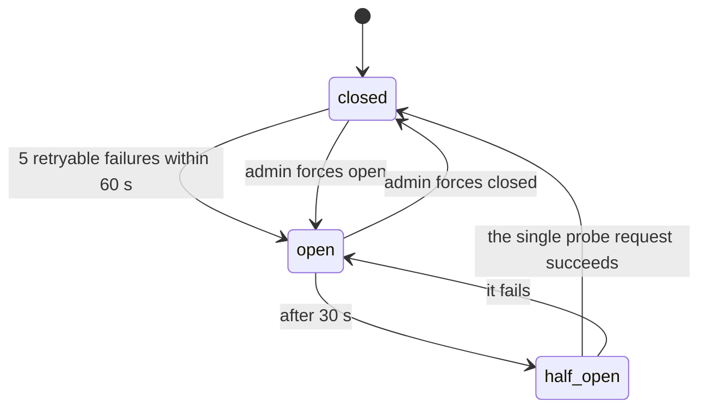

# Routing, failover and health

Code: [`gateway/catalog.ts`](../../apps/api/src/gateway/catalog.ts),
[`gateway/upstream.ts`](../../apps/api/src/gateway/upstream.ts),
[`gateway/breaker.ts`](../../apps/api/src/gateway/breaker.ts),
[`gateway/probe.ts`](../../apps/api/src/gateway/probe.ts),
[`jobs/gateway.jobs.ts`](../../apps/api/src/jobs/gateway.jobs.ts).

## The catalogue

Providers (kind, base URL, credentials), models (public id, aliases, kind, capabilities,
margin, enabled) and routes (model to provider and upstream model id, priority, timeout,
cost, enabled) live in Postgres and are edited in `/admin`. The API loads the usable part
(enabled models, enabled routes on enabled providers with at least one decryptable,
enabled credential) in one pass and caches it for 5 seconds per process. Admin writes
clear the writing process's cache; other processes follow within the TTL.

| Provider kind | Default base URL | Auth | Format |
| --- | --- | --- | --- |
| `OPENAI_COMPATIBLE` | none (required): OpenAI, Groq, Together, DeepInfra, OpenRouter, Mistral, Fireworks, a local vLLM | `Authorization: Bearer` | OpenAI |
| `ANTHROPIC` | `https://api.anthropic.com/v1` | `x-api-key`, `anthropic-version: 2023-06-01` | Anthropic Messages |
| `GEMINI` | Google's OpenAI-compatible endpoint | `Authorization: Bearer` | OpenAI |
| `STUB` | `STUBS_URL/v1` (development) | any | OpenAI |

Several credentials on one provider are used round robin.

## Failover

Routes are tried in priority order (lowest number first). A route is skipped while its
circuit is open. A failure is **retryable** when the connection failed, the route's timeout
passed, or the provider answered 408, 409, 425, 429 or 5xx; the next route is then tried,
as long as no byte has been sent to the caller (so streams fail over only before their
first chunk). Any other answer (400, 401, 403, 404, 413, 422) is the request's or the
configuration's fault; trying elsewhere would fail the same way, so the caller gets a
gateway error at once.

The request row records the route that served it and the number of attempts.

## The circuit breaker

One state per route, in Redis, shared by every API process:

While open, the route is skipped. In half-open, one request at a time may try it. 401 and
403 answers also count as failures (a revoked credential takes the route out until fixed).
If Redis is unreachable, every circuit reads as closed.

## Health probes

Every 5 minutes the worker probes every usable route with a free `GET {base}/models`
using the route's credential, records the result in `health_checks` and feeds the breaker,
so a dead provider is found without traffic. The admin Health page shows each route's
circuit, the last probes, the 24-hour success rate and median latency from real traffic,
and buttons to force a circuit open or closed. The Test button on a route makes one tiny
real call (one output token, one embedding, four characters of speech).

## Price under failover

Whichever route serves a request, the caller pays the model's list price (the primary
route's cost plus margin); see [pricing-and-margins.md](pricing-and-margins.md).
